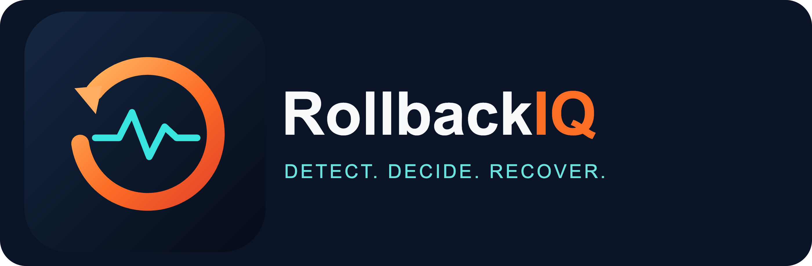
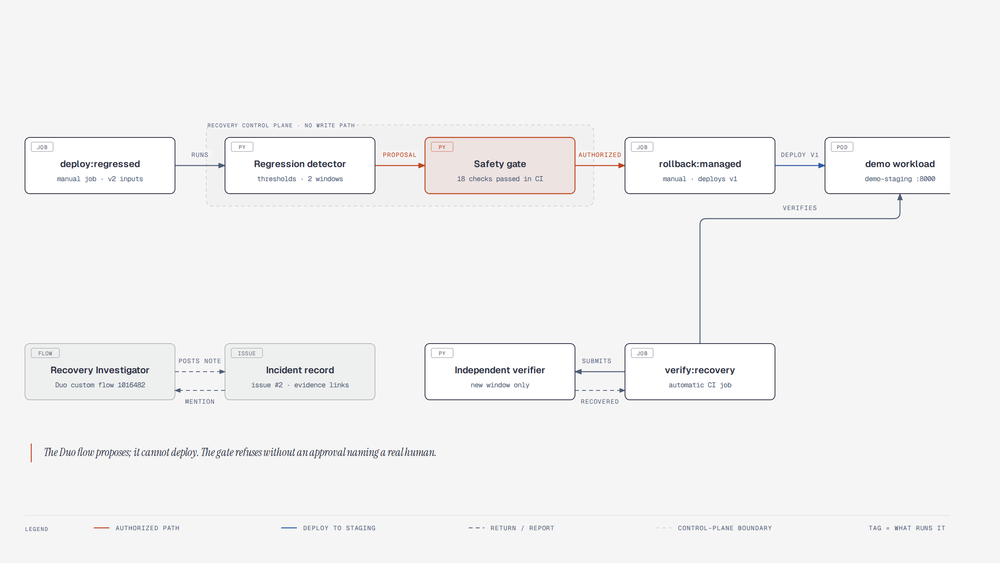
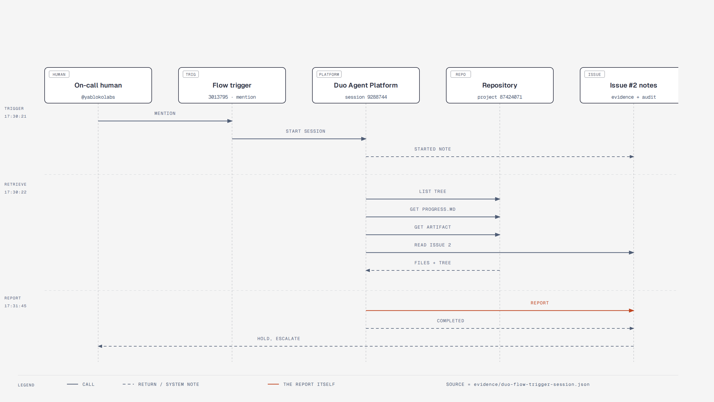
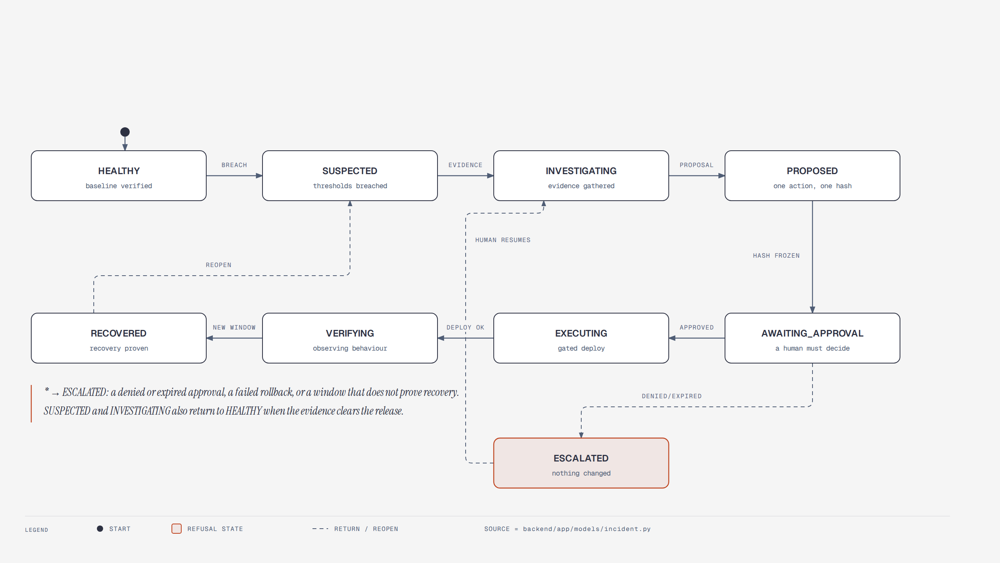
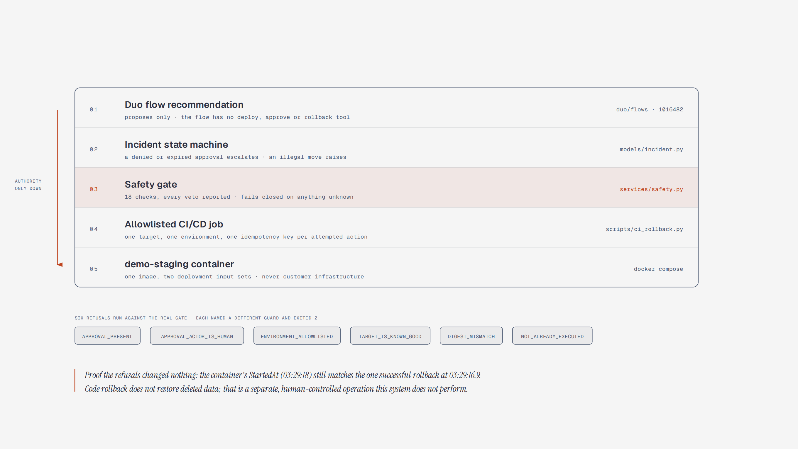
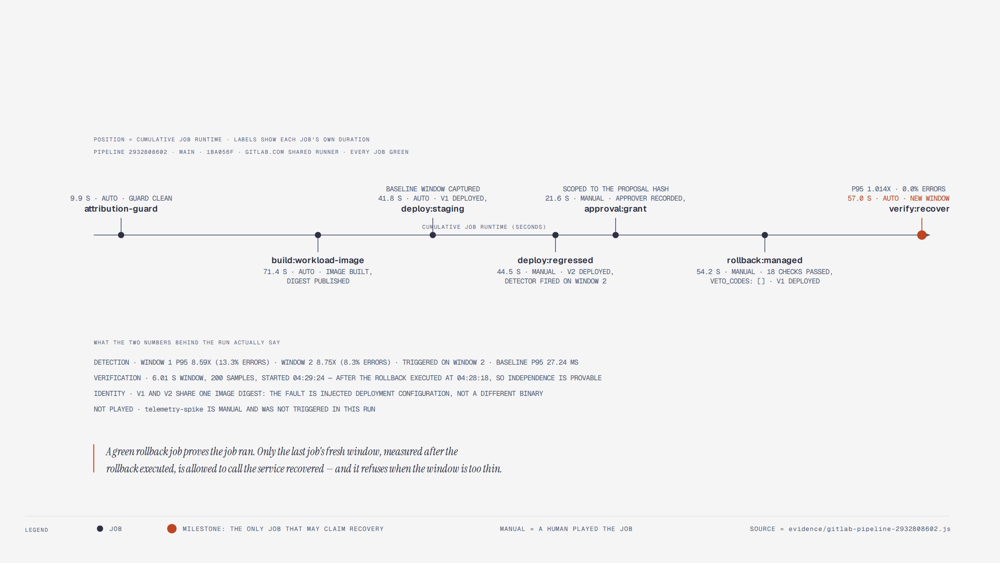

<p align="center">
  
</p>

# RollbackIQ — Detect. Decide. Recover.

**Demonstration video (2:36):** https://youtu.be/rvs6M7xOTR0

**RollbackIQ is a GitLab-native agentic production recovery engineer.** It detects a
deployment regression, gathers evidence, proposes a safe response, requires explicit
human approval before any consequential action, drives a controlled rollback through
GitLab CI/CD, and then **independently verifies that the service actually recovered**.

> **The defining principle: a successful rollback job is not proof of recovery.**
> Observed recovery against a healthy baseline is proof.

Built for the **GitLab Transcend Hackathon (Path A: Start Fresh)**.

## Status — what is implemented today

This repository is honest about its progress. Nothing below claims GitLab execution that
has not happened.

| Area | Status | Evidence |
| --- | --- | --- |
| Healthy/faulty demo workload with real HTTP metrics | **Implemented and verified** | `demo/service/app.py`, `evidence/phase1-regression.json` |
| Deterministic regression detection (thresholds, sustained windows, cooldown) | **Implemented and verified** | `backend/app/services/detector.py`, `backend/tests/test_detector.py` |
| Incident state machine with illegal transitions rejected | **Implemented and verified** | `backend/app/models/incident.py` |
| Safety gate (approval scope/expiry/actor, environment allowlist, known-good target, migration veto, idempotency) | **Implemented and verified** | `backend/app/services/safety.py`, `backend/tests/test_safety.py` |
| Independent post-rollback verification | **Implemented and verified** | `backend/app/services/verifier.py` |
| Docker image and Compose stack for both releases | **Implemented and verified** | `docker-compose.yml`, `demo/service/Dockerfile` |
| Attribution guard (no AI attribution footers) in hooks and CI | **Implemented and verified locally** | `scripts/check_no_attribution.sh`, `.gitlab-ci.yml` |
| OpenTelemetry export to GitLab Observability | **Implemented and verified against the real collector** (64 spans accepted, 0 failures) | `demo/service/otel_setup.py`, `evidence/otel-export-spike.json` |
| GitLab CI/CD deploy, approval gate and rollback | **Implemented and verified in CI** — pipeline `2932808602`, every job green | `evidence/gitlab-ci-lifecycle-artifacts/`, `docs/PROGRESS.md` |
| GitLab Duo investigation | **A real Duo flow executed and returned grounded findings**; a custom agent + custom flow are registered in the AI Catalog and validate server-side | `duo/`, `evidence/duo-flow-runs.json`, `evidence/duo-catalog-items.json` |
| Control-plane API and incident console | **Implemented and verified locally** — the API serves typed JSON read from the pipeline's own artifacts, and every dashboard view renders with no page or console errors | `backend/app/api/incident_api.py`, `dashboard/`, `docs/screenshots/` |
| Diagrammed architecture, security model and evaluation | **Implemented and verified locally** — five diagrams, each self-checked and geometry-audited, plus the documentation set | `docs/diagrams/`, `docs/ARCHITECTURE.md`, `docs/SECURITY.md`, `docs/EVALUATION.md`, `docs/DEMO.md`, `docs/COMPETITION_COMPLIANCE.md` |
| Demonstration video | **Made** — 2:36, narrated, with a recording of a real lifecycle run inside it and the real GitLab pages. Not in it: a person playing the approval job in the GitLab UI | `demo/videos/rollbackiq-demo.mp4`, `demo/videowright/`, `docs/DEMO.md` |

Test suite: **110 passing** (`pytest`).

**On persistence:** `ROLLBACKIQ_BUILD.md` §9 allows SQLite "unless a simpler proven design
suffices", and here it does. The pipeline's artifacts *are* the record — the console reads
`evidence/gitlab-ci-lifecycle-artifacts/` and the Duo session capture directly, so there is no
second copy that can drift from what the pipeline actually wrote. A file the API cannot find is
reported in `missing_artifacts` rather than filled in.

## Measured end-to-end run

From `scripts/demo_regression.py` (raw record: `evidence/phase1-regression.json`), reproduced
twice with the same class of result on a local machine:

| Phase | Measurement |
| --- | --- |
| Healthy `v1` baseline | 150 real requests, 0 errors, p95 **35.6 ms** |
| Faulty `v2` | 11.3% then 8.7% error rate; p95 **238.9 ms = 6.72x** baseline |
| Detection | breached `P95_LATENCY` and `ERROR_RATE` on the second sustained window, after **7.72 s** |
| Rollback | 0.51 s — *a local process restart at the time; the GitLab CI/CD job now exists and is verified in pipeline `2932808602`* |
| Post-rollback window | 400 requests over ~5 s, 0 errors, p95 **28.0 ms = 0.79x** baseline |
| Verification | `recovered=True`, `independent=True` |
| Totals | time to verify 5.22 s; detection-to-verified-recovery 5.43 s; total **13.16 s** |

## Quick start

```bash
# 1. Python environment
python3 -m venv .venv
.venv/bin/pip install -r backend/requirements.txt

# 2. Tests
.venv/bin/python -m pytest            # 110 passing

# 3. The full regression demonstration (healthy -> faulty -> detected -> rolled back -> verified)
.venv/bin/python scripts/demo_regression.py

# 4. The workload on its own
docker compose up -d workload-v1      # healthy release
curl -s localhost:8000/release
curl -s localhost:8000/metrics

# faulty release (same image, different deployment inputs)
RELEASE_VERSION=v2 FAULT_LATENCY_MS=180 FAULT_ERROR_RATE=0.10 \
  docker compose --profile faulty up -d workload-v2
```

## How it works



```
deployment (GitLab CI/CD)            real user traffic
        |                                    |
        v                                    v
  demo workload  -------------------->  HTTP probes (observer)      <-- measurement comes from the
  /metrics, /release                    backend/app/services/collector.py    observer, not the service
        |                                    |
        |                                    v
        |                            regression detector  (thresholds, sustained windows, cooldown)
        |                                    |
        |                                    v
        |                         incident state machine  (HEALTHY -> ... -> RECOVERED / ESCALATED)
        |                                    |
        |                                    v
        |                       GitLab Duo investigation  (custom flow in the AI Catalog)
        |                                    |
        |                                    v
        |                            recovery proposal + risk
        |                                    |
        |                                    v
        |                            SAFETY GATE (human approval, allowlist, known-good target,
        |                                    |         migration veto, idempotency)
        |                                    v
        |                          GitLab CI/CD rollback job  (approval-gated, implemented)
        |                                    |
        v                                    v
     previous release  <--------  independent verifier  (new post-rollback observations only)
                                             |
                                             v
                                  incident record + audit trail
```

Design rules that make this trustworthy:

- **Detection is arithmetic, not an opinion.** Thresholds, minimum sample counts, sustained
  windows and cooldowns are deterministic; the numbers come from real requests.
- **Thin evidence never triggers.** No verified baseline, too few samples, or an environment
  mismatch suppresses detection instead of guessing.
- **The safety gate reports every veto**, not just the first one, and refuses when migration
  compatibility is unknown rather than assuming it is safe.
- **Verification refuses to reuse the incident data.** An unknown rollback execution time means
  independence cannot be claimed, so recovery is not confirmed.
- **Measurement is independent.** The observer's own probe latencies are used, not the
  service's self-report.

## Repository layout

```
assets/brand/             the logo and the icon, each as SVG and PNG
backend/app/api/          read-only incident API over the pipeline's own artifacts (+ serves the console)
backend/app/models/       incident state machine, metric windows, releases, approvals
backend/app/services/     detector, safety gate, verifier, collector, stats
backend/tests/            unit, negative and integration tests
dashboard/                the incident console (React + TypeScript + Tailwind)
docs/diagrams/            five diagrams (HTML + SVG source, rendered PNG) and their checks
docs/ARCHITECTURE.md      components, the two flows, the constraints and known limitations
docs/SECURITY.md          the trust boundary, every gate check, injection and secret handling
docs/EVALUATION.md        measured results, how each was verified, and what they do not show
docs/DEMO.md              reproduction paths and the under-3-minute video storyboard
docs/INCIDENT_RUNBOOK.md  what the person on call does, step by step, and what each refusal means
docs/COMPETITION_COMPLIANCE.md   stage-by-stage coverage, and what is not claimed
demo/service/             the deployed workload (v1 healthy, v2 faulty) + Dockerfile
demo/videowright/         the demonstration video project (scenes, narration, live-run footage)
demo/videos/              the demonstration video, its subtitles, and the earlier silent recording
duo/                      custom Duo agent prompt + flow definition (provisioned to the AI Catalog)
scripts/                  demo regression runner, attribution guard, catalog provisioning, Git hooks
evidence/                 raw measured records from real runs
docs/PROGRESS.md          session checkpoint and current blockers
```

## Reproduce the whole lifecycle on one host

```bash
bash scripts/demo_lifecycle_local.sh     # ~32 s, real containers, no demo-only code path
```

It runs the same scripts the CI jobs run: deploy v1 and measure the baseline, require the real detector
to fire on v2, approve one hashed proposal, evaluate the gate without changing anything, execute the
authorized rollback, then verify recovery from a **new** window. It exits non-zero when the verifier
refuses, which is a correct outcome rather than a bug. `scripts/record_demo.py` records that run and the
console into `demo/videos/rollbackiq-local-run.mp4`. The narrated demonstration video is
`demo/videos/rollbackiq-demo.mp4`; `demo/videowright/README.md` says how it is built.

## Diagrams and documentation

| Diagram | What it shows |
| --- | --- |
| [Architecture](docs/diagrams/architecture.png) | Components and the one authorized path to a deployment change (shown above) |
| [Duo flow sequence](docs/diagrams/duo-flow-sequence.png) | The mention trigger, the custom flow session and the note it posts |
| [Incident state machine](docs/diagrams/incident-state-machine.png) | Every state and the transitions the code permits |
| [Trust boundary](docs/diagrams/trust-boundary-layers.png) | The layers between agent reasoning and a deployment |
| [Pipeline timeline](docs/diagrams/pipeline-timeline.png) | The measured timeline of pipeline 2932808602 |









```bash
.venv/bin/python scripts/render_diagrams.py         # self-check + render each diagram to PNG
.venv/bin/python scripts/check_diagram_geometry.py  # measured audit of the connector rules
```

The five diagrams (architecture, Duo sequence, incident state machine, trust-boundary layers,
measured pipeline timeline) are drawn with the [`diagram-design`](https://github.com/cathrynlavery/diagram-design)
skill and each is one self-contained HTML file with an inline SVG. `render_diagrams.py` runs the
skill's own accessible-SVG check and then screenshots only the `<svg>` node; the geometry audit
measures what cannot be eyeballed — text collisions, off-canvas text, diagonal connectors, and
label masks sitting on node boxes. See `docs/diagrams/README.md`.

## The incident console

The console is one service that answers "what happened, and what proves it". It has no write path: it
reads the artifacts the pipeline and the Duo flow themselves wrote and renders them.

```bash
 .venv/bin/uvicorn app.api.incident_api:app --app-dir backend --port 8000
#  -> http://127.0.0.1:8000/            the console (requires dashboard/dist)
#  -> http://127.0.0.1:8000/api/incidents

cd dashboard && npm install && npm run build     # build the console
.venv/bin/python scripts/screenshot_dashboard.py # render every view; fails on a page or console error
```

The views are Overview, Timeline, Investigation (the real Duo session and the note it posted),
Approval centre (all 18 safety-gate checks, the approver, the proposal hash), Verification, and the
Incident report. `scripts/screenshot_dashboard.py` doubles as the render check: it waits for each
view's real content and exits non-zero on any uncaught page error or `console.error`, because a
bundle that compiles but renders nothing is still a broken console. It writes
`docs/screenshots/*.png` from the real incident, not from fixtures.

## Safety model

- Human approval is mandatory before a rollback; approvals are scoped to one exact proposal
  hash, so approving one action never authorizes a different one.
- Non-human actors (`system`, `agent`, and similar) cannot approve.
- Rollback targets must be releases this system observed as healthy. Unknown target, target
  equal to the current release, environment mismatch, unsafe/unknown migration and duplicate
  idempotency keys all refuse.
- **Code rollback does not restore deleted data.** Data restoration is deliberately out of
  scope and remains a separate, human-controlled operation.
- Retrieved telemetry, commit messages and issue text are treated as untrusted evidence, never
  as instructions.

See `AGENTS.md` and `ROLLBACKIQ_BUILD.md` for the full product and safety specification.

## Observability

The demo workload exports real OpenTelemetry traces to the collector configured through
`OTEL_EXPORTER_OTLP_ENDPOINT`, with the resource attributes GitLab documents so a trace
links back to the project and the exact deployed commit (`gitlab.project.id`,
`gitlab.project.name`, `service.version`, `deployment.environment.name`).

Telemetry is opt-in and can never break the workload: with no collector configured the
service runs exactly as before, and its own `/otel` endpoint reports what the telemetry
layer actually did — including a counter wrapped around the real exporter, so spans are
only reported as sent once the collector accepted the batch. `demo/otel.env.example`
shows the configuration (no credentials in the repository).

`scripts/otel_export_evidence.py` proves the path end to end: it starts the workload as
deployed, sends genuine requests, flushes, and exits non-zero unless spans were accepted
with zero failures. It is also a manual CI job (`telemetry-spike`) so the export can be
re-proven on a GitLab runner.

## Hackathon workspace

This repository lives in the provided Transcend Hackathon workspace project for `@yablokolabs`
(DevPost: `yablokolabs`), which also hosts the [onboarding issue](https://gitlab.com/gitlab-ai-hackathon/transcend-october-2026/43178176/showcase/-/work_items/1).
The workspace starter `README.md` that this file replaces remains in history at commit
`a4d8a7ad`, and the workspace starter commit is kept as the first parent of the merge that
brought this project into the repository.

## Licence

MIT — see `LICENSE`.
